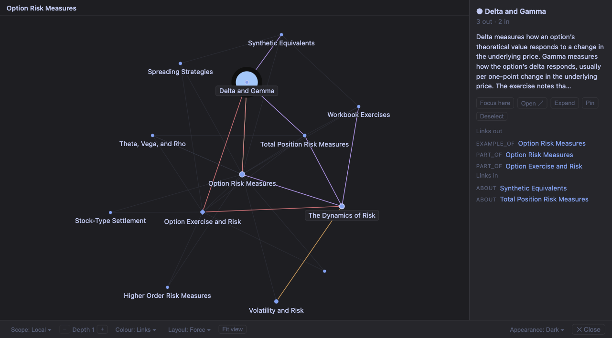
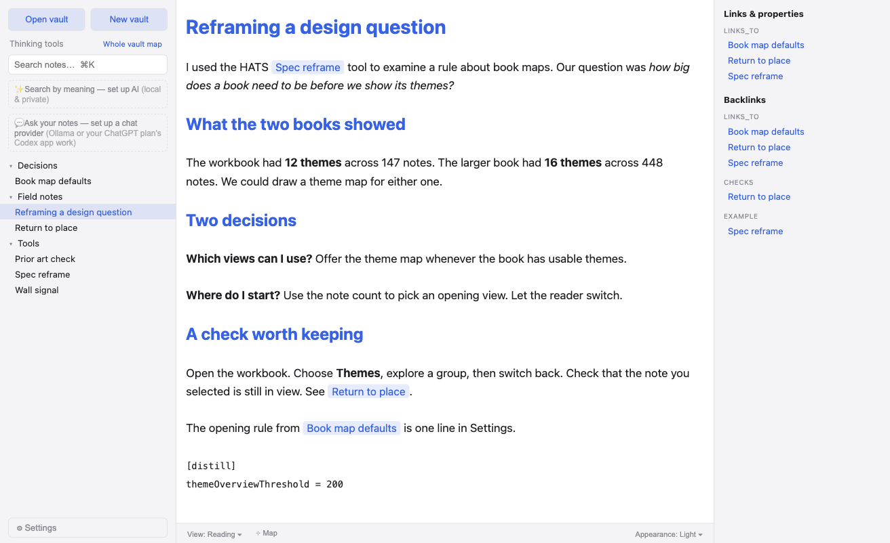

# Nodebook

Write in Markdown, link your notes, and turn a book into a map of ideas. Each note extracted from a passage links back to the text so you can check it. Your files stay in a folder you can open in any Markdown editor.

[Download Nodebook for macOS, Windows or Linux](https://github.com/mrbald/nodebook/releases/latest) · [User guide](src/renderer/src/help.md)



Risk measures in Sheldon Natenberg’s *Option Volatility & Pricing Workbook*. Select a note to read its summary. Hover over a neighbour to trace its connections.

The screenshots and guide describe Nodebook 0.2.0. [Latest published release](https://github.com/mrbald/nodebook/releases/latest)

## Install Nodebook

The Electron 45 build requires macOS 13 (Ventura) or later on both Apple silicon and Intel Macs. For macOS 12 (Monterey), use [Nodebook v0.1.1](https://github.com/mrbald/nodebook/releases/tag/v0.1.1).

| Computer | What to download from GitHub |
| --- | --- |
| Mac with Apple silicon | The DMG ending in `-arm64.dmg` |
| Mac with an Intel processor | The DMG ending in `-x64.dmg` |
| Windows | `-setup.exe` for the installer, or `-portable.exe` to run without installing |
| Linux on x86-64 | The `.AppImage` or the `amd64.deb` package for Debian-based systems |

On a Mac, open the DMG, drag **Nodebook** to **Applications**, then open it there. The GitHub downloads are ad-hoc signed. If macOS says it cannot verify Nodebook, dismiss the message. For a copy you trust, choose **System Settings → Privacy & Security → Open Anyway** and confirm. [Apple’s first-launch instructions](https://support.apple.com/en-us/102445)

## Write and connect two notes

1. Choose **New vault** to start a folder for your notes, or **Open vault** to use an existing folder.
2. Choose **File → New Note**, name it `Spec reframe`, and write a sentence. Save with **⌘S** on Mac or **Ctrl+S** on Windows and Linux.
3. Create a note called `Design review`. Write `I used [[Spec reframe]] to revisit the opening view.` and save.
4. Click the link. The **Backlinks** panel on *Spec reframe* now lists *Design review*. Choose **Map** below the note to see the connection.



This working note uses the HATS *Spec reframe* tool to record a design decision. Choose **Reading** to see the finished note or **Live preview** to edit it.

## Read a book alongside your notes

Choose **File → Distill a Document…** and pick a PDF, EPUB, Word (`.docx`), HTML, Markdown or text file. For a text import, check the preview and change the encoding if the letters look wrong.

Open the finished book and click a note’s citation to read the passage it came from. For a book with themes, choose **Scope → Standalone**, then **View → Themes**. Choose **Overlay** to see the book alongside your notes. **Merge book…** previews what will be added to your vault. [Book import, figures and Undo](docs/distill-documents.md)

## Search, privacy and backups

- **Keyword search** works locally. **Search by meaning** downloads a model on first use, then searches on your computer. [Search and Ask](docs/talk-to-docs.md)
- **Ask** sends your question and relevant passages to the chat provider you choose. **Distill** sends book passages. **Analyze figure** sends the image, its label, its place in the book, and any caption or recognized text. Choose a local model to keep this material on your computer. [Provider setup](docs/cli-providers.md)
- **Back up the whole vault**, including the hidden `.distill/` folder for unfinished books and merge history. Keep original documents for **Open original**. Back up the app profile too if you want to keep recovered reading copies or figure analyses. [How to restore your work](docs/state-and-scopes.md)

## Run from source

Use Node.js 22.13 or later in the 22.x series, or Node.js 24 or later, with npm. Run these commands from a clone of this repository.

```sh
npm ci
npm run dev
```

Use `npm run build` for a production build and `npm start` to preview it. Run `npm run lint`, `npm run typecheck`, and `npm test` for the code checks. `npm run test:e2e` builds and drives the desktop app and needs a graphical session. [Release procedure](RELEASING.md) · [Roadmap](ROADMAP.md)

## License and support

Nodebook is licensed under [AGPL-3.0-or-later](LICENSE). For commercial licensing enquiries, [open an issue](https://github.com/mrbald/nodebook/issues). You can also [support development](https://www.buymeacoffee.com/gt9gt7cvwmg).

I designed Nodebook and used Anthropic’s Claude and OpenAI Codex to write much of the code.
